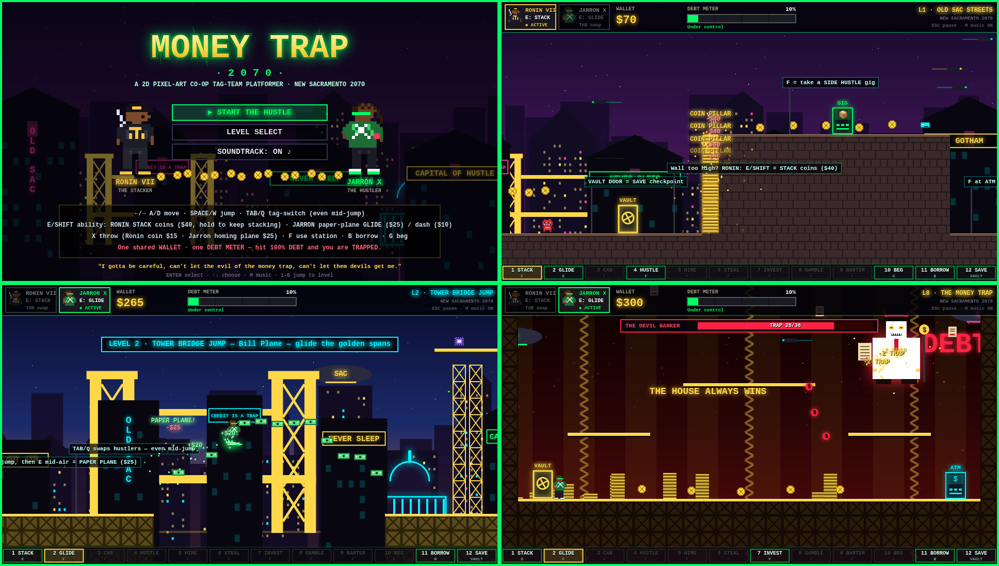
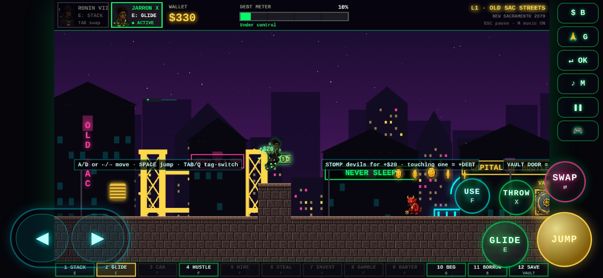
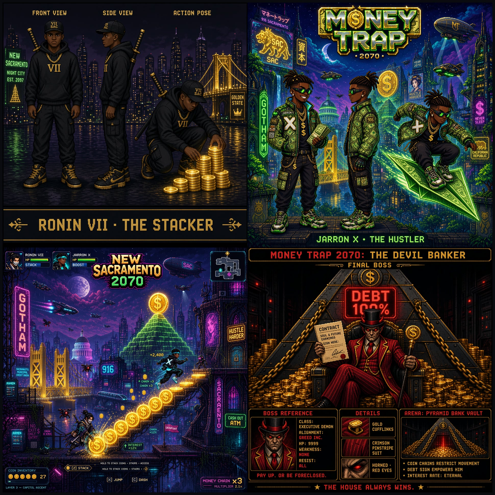
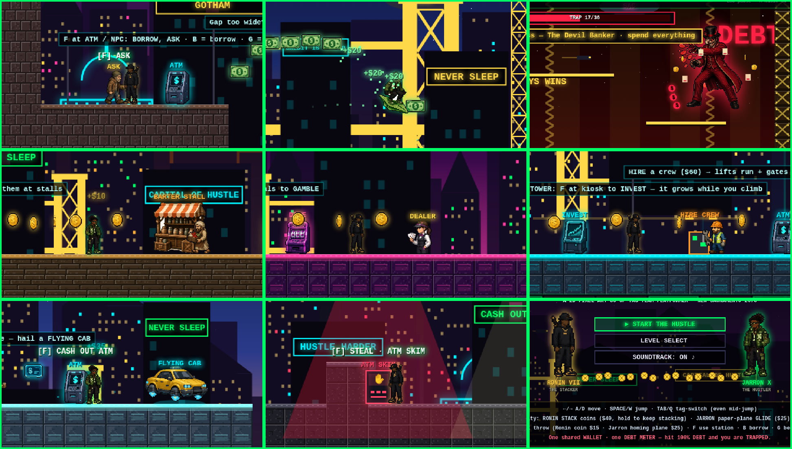
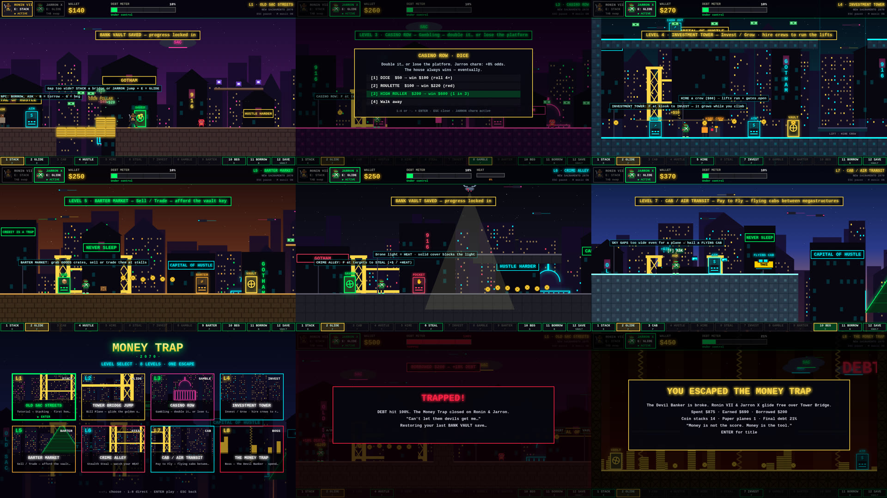

# 💰 MONEY TRAP 2070

**A 2D pixel-art co-op tag-team platformer.** Two hustlers from the tough streets of Sacramento, **Ronin VII** and **Jarron X**, have to escape a utopic, Gotham-style cyberpunk **New Sacramento 2070** by using money itself as the tool.

> *Money is not the score. Money is the tool. Stack it. Fold it. Spend it. Invest it. Lose it, and the trap closes.*

- Plain JavaScript + HTML5 Canvas, with **0 dependencies**, no build step and no backend
- 8 playable levels and a boss fight, plus 12 money-as-mechanic systems
- Hand-cut **pixel-art sprite atlas**: multi-frame Ronin VII & Jarron X animations, a towering Devil Banker boss, NPCs and props (see [Sprites](#-sprites))
- Soundtrack: **"Money Trap"**, an original song by the creator (toggle it with `M`). Retro sound effects are generated with WebAudio.



## 📱 Play it on your phone (no computer needed)

**▶ [money-trap-2070.vercel.app](https://money-trap-2070.vercel.app)**: open it in Safari (iPhone) or Chrome (Android). Tap anywhere on the title screen to start. That same tap also turns on the soundtrack.

- On touch devices, translucent cyberpunk touch controls show up automatically. Desktop players can show or hide them with the 🎮 button.
- It plays in **landscape and portrait**. In portrait the game sits at the top and the controls sit underneath it. You'll get a small "rotate for best view" hint, and you can dismiss it.
- Multi-touch works: you can hold ▶ while you hit JUMP and STACK/GLIDE at the same time. You can also slide your thumb between ◀ and ▶ without lifting it.
- Tip: use *Share → Add to Home Screen* to get a full-screen, app-like launch.



## ▶️ Run it locally

```bash
git clone https://github.com/eyeoverthink/money-trap.git
cd money-trap
open index.html            # macOS (or just double-click it)
# or serve it:
python3 -m http.server 8000   # then visit http://localhost:8000
```

There's nothing to install, and it works offline.

## 🧍 Characters

| | **RONIN VII**: The Planner / Stacker | **JARRON X**: The Hustler / Booster |
|---|---|---|
| Look | Black hoodie with gold **VII**, katana, **VII SAC** cap, gold chain | Green money-print bomber with a big white **X**, **916** patch, green shades, dreads |
| Vibe | Quiet, samurai code, calculates interest. *"Don't chase the money. Make the money hold still."* | Loud, charismatic, talks his way through |
| Ability (`E`) | **STACK** ($40 a block; hold to keep stacking) glowing gold coins into bridges, stairs and pillars, or drop one under himself mid-air | **PAPER PLANE GLIDE**: in mid-air, folds bills into a glowing plane ($25). On the ground: speed dash ($10) |
| Perk | Investments grow faster | **Charm**: 25% off cabs, crews, tolls and the vault key; +8% gambling odds |

**Tag rule:** switch anytime with `Tab` / `Q`, even mid-jump. *Ronin builds the platform. Jarron flies off it.* Both hustlers share **one wallet and one DEBT meter**.



## 🎮 Controls

| Key | Action |
|---|---|
| `←/→` or `A/D` | Move |
| `Space` / `W` / `↑` | Jump (hold it to jump higher) |
| `Tab` / `Q` | Tag-switch Ronin ↔ Jarron (works mid-jump) |
| `E` / `Shift` | Ability: Ronin **STACK** · Jarron **GLIDE** / dash |
| `X` / `J` | Throw: Ronin's gold coin ($15, hold `↑` to throw diagonally) · Jarron's homing paper plane ($25) |
| `F` / `↓` | Use the station you're at (hustle, ATM, ask, gamble, invest, hire, barter, steal, cab, toll) |
| `B` | Borrow +$200 (+18% DEBT), anywhere |
| `G` | Beg when you're broke (+$20, +4% DEBT) |
| `M` | Turn the soundtrack on or off |
| `Esc` / `P` | Pause: resume / restart / level select / title |
| `1`–`8` | On the title or level-select screen, jump straight to a level |

**Touch controls (phones and tablets)**

| Button | Action |
|---|---|
| ◀ ▶ (bottom-left) | Move. Slide your thumb between them |
| **JUMP** (big gold) | Jump (hold it to jump higher) |
| **STACK / GLIDE** | Ability. The label follows the active hero: Ronin STACK (hold to keep stacking), Jarron GLIDE / dash |
| **SWAP** | Tag-switch Ronin VII ↔ Jarron X (works mid-jump) |
| **THROW** · **USE** | Throw a coin or paper plane · use the station you're at |
| `$ B` · `🙏 G` (top bar) | Borrow · beg |
| `↵ OK` · `♪ M` · `❚❚` · `🎮` | Confirm/continue · soundtrack · pause/back · show or hide the touch controls |
| Tap the screen | Start from the title. Pick menu rows, levels and station options. Continue after a level clear, TRAPPED or victory. Tap outside a station menu to close it |

## 💸 Core rules

- **Shared Wallet.** Collects currency from the past, present and future: gold coins ($10), paper bills ($20), holo-credits ($35), crypto chips ($50).
- **DEBT Meter (0–100%).** Loans, devils, falls, fines, interest and the Devil Banker all push it up. **At 100% you're TRAPPED!** and you restart from your last Bank Vault save.
- **Heat Meter** (Crime Alley). Stealing raises Heat, and so does standing in a patrol drone's light. Solid cover blocks the light. At 100% you're **BUSTED**.
- **Save = Bank Vault.** Touch a glowing vault door to lock in a checkpoint. If you have an investment running, it also earns +5%.

## 🏦 The 12 Money Systems

| # | System | How it plays |
|---|---|---|
| 1 | **Stack Coins** | Ronin builds coin bridges, stairs and pillars ($40 each) |
| 2 | **Fold Bills → Paper Plane** | Jarron glides across wide gaps ($25) |
| 3 | **Cab / Air Transit** | Pay a flying cab ($90) to cross sky gaps between megastructures |
| 4 | **Hustle Side Jobs** | Courier gigs: deliver to the DROP beacon within 40s for +$120 |
| 5 | **Hire Workers** | Pay a crew ($60) to run the lifts and hold gates open for 25s. Unpaid crews walk off |
| 6 | **Crime Ring Steal** | Big cash, but your Heat goes up |
| 7 | **Invest** | Investment Tower kiosks: your money grows over time (watch out for market dips) |
| 8 | **Gamble** | Casino Row dice, roulette and high-roller bets |
| 9 | **Sell / Barter** | Sell goods crates or trade 3 for the vault key |
| 10 | **Beg / Ask** | Emergency cash, paid for with a little pride (+DEBT) |
| 11 | **Borrow** | Instant +$200, +18% DEBT |
| 12 | **Save** | Bank Vault checkpoints |

## 🎨 Sprites



The sprites are made the same way as [Fraymus Quest](https://github.com/eyeoverthink/fraymus-quest): a script cuts them from pose-sheet reference art.
`tools/build_sprites.py` does the following:
1. Flood-fills the white background from the border.
2. Splits the sheet into one connected piece per pose. Stray bits, like a thrown coin or a paper plane, are merged into the nearest pose.
3. Downscales using only the character's own pixels, so there's no white fringe. A "salient colour" rule keeps the gold `VII`, the green shades and the red eyes visible.
4. Quantizes each sprite to its own palette and adds a 1-px dark outline.
5. Packs every frame into `assets/sprites/atlas.png`, plus a `sprites.js` frame table with a feet anchor for each frame.

| Sprite | Frames |
|---|---|
| Ronin VII | idle, breathing idle, 4-frame run, jump, fall, **STACK** crouch, throw |
| Jarron X | idle, 4-frame run, jump, fall, **paper-plane glide**, dash (with afterimages), throw |
| The Devil Banker | idle (contract + gold `$` cane), attack (hex-coin cast), phase-2 rage (flame aura), white hit-flash for each frame, swirling coin/contract aura |
| World | street devil, patrol drone (with scan cone), crew worker, casino dealer, market merchant, street beggar, fence, flying taxi, Bank Vault door, ATM, slot terminal, invest kiosk, barter stall, coins, bills, holo-credits, crypto chips, goods crates |

Every sprite is drawn 1:1 with `imageSmoothingEnabled = false`. If the atlas can't load, the game falls back to its built-in procedural pixel sprites.
To rebuild the atlas: `pip install pillow numpy scipy && python3 tools/build_sprites.py`. The source pose sheets are in `art-src/`.

## 🗺️ 8 Levels: New Sacramento 2070

| Level | Name | Core tool |
|---|---|---|
| 1 | **Old Sac Streets** | Coin-stacking tutorial + first side hustle |
| 2 | **Tower Bridge Jump** | Paper-plane glides across the golden bridge spans |
| 3 | **Casino Row** | Gamble terminals, charming dealers, the $350 high-roller toll bridge |
| 4 | **Investment Tower** | Vertical climb: invest to grow, hire crews to run 3 lifts and hold the gates open |
| 5 | **Barter Market** | Sell / trade goods to afford the vault key |
| 6 | **Crime Alley** | Stealth steal with patrol drones and Heat; take the keycard |
| 7 | **Cab / Air Transit** | Flying cabs across sky gaps, gliding the air lanes, to reach the Pyramid Bank |
| 8 | **The Money Trap (Boss)** | **The Devil Banker**. Spend everything you have (coin throws plus a paper-plane barrage) to shatter the trap and glide free |



## 🧪 Tested

The game was tested in headless Chromium with Playwright. It passed 32/32 checks, with zero console or JS errors:
- moving, jumping, and tag-switching mid-jump
- Ronin's coin pillar and coin bridge, and Jarron's glide across the bridge gaps
- level select and the pause menu
- the gamble terminals, borrowing, the Investment Tower lifts and the flying cabs
- boss damage and the victory screen, TRAPPED and the restore, and the music toggle

**Mobile:** Playwright ran on iPhone 14 emulation in landscape (844×390) and portrait (390×844), with `hasTouch` on. All 15 of 15 checks passed in each orientation, with zero console or JS errors. The checks covered tap-to-start, holding ▶, sliding to ◀, holding ▶ while pressing JUMP and STACK with multi-touch, swapping, the action label following the active hero, pausing and resuming by tap, and the canvas fitting the screen. The live Vercel URL also passed the same suite. (`qc/qc_mobile_results.json`, `qc/qc_mobile_live_results.json`)

Frame-by-frame traversal checks also confirmed that every gap, wall, lift, toll, key and keycard exit can be completed.

## 📁 Project layout

```
index.html                  # canvas + audio shell
sprites.js                  # generated sprite-atlas frame table
assets/sprites/atlas.png    # generated pixel-art sprite atlas
tools/build_sprites.py      # atlas builder (art-src/*.jpg → atlas)
art-src/                    # pose-sheet source art
game.js                     # the whole game (sprites, levels, physics, HUD, boss): plain JS, no deps
assets/money-trap-theme.*   # soundtrack (.m4a + .mp3 fallback)
screenshots/                # gameplay QC grids + pixel-art sheet
reference/                  # pixel-art reference panels (Ronin VII, Jarron X, New Sacramento 2070, Devil Banker)
```

---
*"I gotta be careful, can't let the evil of the money trap, can't let them devils get me."* (from "Money Trap")
